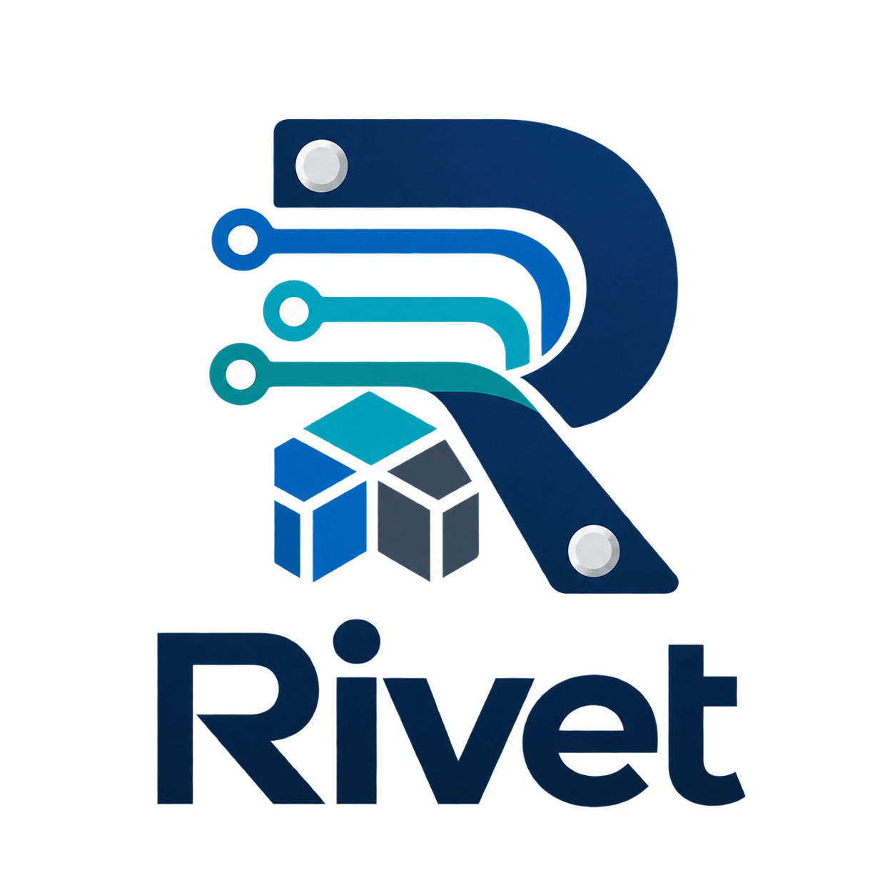

<div align="center">

  

  <h1>Rivet</h1>

  <p>
    <strong>Rust and Python image data pipeline</strong>
  </p>

</div>

Rivet is a Rust and Python image data pipeline for loading, transforming, and
batching datasets. It provides zero-copy tensor views where possible, bounded
multi-worker loading, deterministic sampling, and optional Lance-backed dataset support.

The Rust [pipeline IR](docs/pipeline-ir.md) supports executable DAGs with shared
inputs and image branch joins, while retaining the CPU linear fast path.

## Downloading datasets

`rivet.download_dataset()` returns a local `Path` for a Hugging Face dataset
repository, Git checkout, HTTP(S) file or archive, or a torchvision dataset root.

```python
import rivet

snapshot = rivet.download_dataset("hf:ylecun/mnist")
checkout = rivet.download_dataset("git:owner/dataset", revision="v1")
archive = rivet.download_dataset("https://example.org/dataset.tar.gz")
train = rivet.load_dataset("https://example.org/images.parquet", split="train")
```

`git:owner/repo` and `github:owner/repo` resolve to GitHub. Use
`git:https://host/owner/repo.git` or `git:ssh://git@host/owner/repo.git` for
other hosts. Git downloads require the `git` executable. Hugging Face uses
the Hub token from `HF_TOKEN` or the saved Hugging Face token file.
Pass `revision` for a Git or Hugging Face branch, tag, or commit.

Original downloads go to `$XDG_CACHE_HOME/rivet/downloads`, and prepared
datasets go to `$XDG_CACHE_HOME/rivet/datasets`. The default XDG cache root is
`~/.cache`. With `cache_dir`, originals go to `<cache_dir>/downloads` and
prepared bundles to `<cache_dir>/<dataset>/<cache-key>`. Use `offline=True` to
use only cached files. The first
successful download is reused for the same source and revision. Pin a commit
for reproducibility or remove the corresponding cache entry to update a
moving branch. Rivet retains the original HTTP archive and extracts a separate
copy by default. Pass `extract=False` to skip extraction.

By default `download_dataset()` only populates the original cache.
`rivet.load_dataset("hf:uoft-cs/cifar10", split="train")` prepares the downloaded
data as Arrow IPC File, then opens the prepared image split with mmap. A local
path returned by a Rivet download can trigger the same preparation. Prepared
bundles are cached under `datasets/<dataset>/<cache-key>` and reused on later
loads.
Source readers accept Parquet, Arrow IPC File or Stream, CSV, TSV, JSON, JSONL,
and, with the optional `lance` feature, Lance bundles. Rivet also supports ZIP
and TAR downloads plus standalone compressed tabular files. Supported torchvision sources also prepare Arrow IPC File.
Use `data_files` for ambiguous downloads or to select a subset of files.
To prepare a tabular dataset without opening it as an image dataset, call
`download_dataset(source, format="arrow")`. Text readers can open its split
files with `rivet.text.TextDataset.from_arrow()`. The preparation formats are
`arrow-ipc-file` (`arrow` is an alias), `arrow-ipc-stream`, and `lance`.
Each format has its own cache key in the same dataset directory.

### Download from Rust

Use `rivet_data::dataset::download_dataset` with `DownloadOptions` for the
same cache, archive extraction, and optional format conversion.

```rust
use rivet_data::dataset::{DownloadFormat, DownloadOptions, download_dataset};

let dataset = download_dataset(
    "hf:SetFit/sst5",
    &DownloadOptions {
        format: DownloadFormat::Arrow,
        ..DownloadOptions::default()
    },
)?;
```

For `torch:` sources, `download_dataset_with_torch` accepts a
`TorchDatasetProvider` for cache misses. The Python binding supplies
torchvision as that provider.

Use `rivet_vision::api::load_dataset` to
open a local image dataset or prepare a remote source as Arrow IPC File.
The result is `DatasetLoadResult::Single` for a physical dataset or a selected
split, and `DatasetLoadResult::Bundle` for a collection of named splits.

```rust
use rivet_vision::api::{LoadDatasetOptions, load_dataset};

let train = load_dataset(
    "./images",
    &LoadDatasetOptions {
        split: Some("train".into()),
        ..LoadDatasetOptions::default()
    },
)?;
```

Local conversion bundles live under the same dataset cache directory. Their
v2 manifests record `"extensions": {"rivet.origin": "local"}`, which lets
Rivet identify local datasets regardless of their physical storage format.

### List cached datasets

`rivet.list_datasets()` inventories completed downloads, prepared bundles,
and local Lance datasets under the XDG cache. Pass `cache_dir`
to scan a different root. The scan reads cache metadata and works offline.

```python
import rivet

for item in rivet.list_datasets():
    print(item["name"], item["kind"], item["path"], item["splits"])
```

Each cached variant has its own entry. A download's source and revision
are included when an import manifest records them.

### Use the command line

The wheel installs a `rivet` command. Build and install it in the target
Python environment.

```bash
maturin build --release -j 12
python -m pip install /path/to/rivet.whl

rivet list
rivet list --json
rivet download hf:SetFit/sst5 --format arrow
rivet download torch:CIFAR10 --format arrow --offline
```

`rivet list` shows the original format, all prepared formats for the selected
original download, and the union of their splits in one row per dataset name.
Use `--all` to show separate original download variants. With `--json`,
`prepared_variants` lists all preparations in a row and `prepared` gives the
preferred preparation.
Both commands accept `--cache-dir`. Run `rivet download --help` for
revision, archive extraction, and split selection options.

Delete a dataset using the exact name shown by `rivet list`. By default this
removes all matching original downloads and preparations. To remove one
prepared format, pass `--format`. The Python API is
`rivet.delete_dataset(name, cache_dir=None, format=None)` and returns the
number of cache entries removed.

```bash
rivet delete cifar10 --format lance
rivet delete uoft-cs/cifar10
```

### Download torchvision datasets

With torchvision installed, use `torch:<class-name>` to download original
dataset files. For supported image classification datasets such as CIFAR-10,
Rivet prepares those files as Arrow IPC File splits on first load.

```python
import rivet

train = rivet.load_dataset("torch:CIFAR10", split="train")
bundle = rivet.download_dataset("torch:CIFAR10", format="arrow", offline=True)
```

Rivet retains raw files under `$XDG_CACHE_HOME/rivet/downloads/torch` and
writes prepared splits under `datasets/<dataset>/<cache-key>` in the same cache.
Rust losslessly encodes the pixels and preserves the original class IDs,
class names when available, and sample order. `offline=True` reuses a
completed conversion or converts an existing raw download. The default
`format="raw"` returns the original files when needed. Names are
case-insensitive and query options select constructor arguments, for
example `torch:CIFAR10?split=test`. Classes with a boolean `train`
argument use both splits unless a split is specified.

### Convert downloads to Lance

Build with `--features lance` and pass `format="lance"` to convert supported tabular files.
Conversion runs in the Rivet Rust extension. The example uses `pylance` to
read the resulting text table.

```python
import lance
import rivet

root = rivet.download_dataset("hf:SetFit/sst5", format="lance")
print(lance.dataset(root / "train.lance").count_rows())

root = rivet.download_dataset(
    "git:clinc/oos-eval",
    revision="828f8093932c8fe6ca7936c3d2e52903b1c523de",
    format="lance",
    data_files="data/data_full.json",
    json_columns=("text", "label"),
)
```

Conversion supports Parquet, Arrow IPC, CSV, TSV, JSON Lines, and JSON
record arrays. It infers common split names from filenames or directory
names. Pass `data_files="relative/file.json"` to select a single file,
including a JSON object whose keys are splits and whose values are record
arrays. For repositories with multiple variants, pass a mapping such as
`data_files={"train": "data/variant/train-*.parquet", "test": "data/variant/test-*.parquet"}`.
Files selected for the same split are combined. Use `json_columns` to name
the fields of positional JSON records.

The returned directory contains `dataset.json` and one `<split>.lance`
directory per split. Text and other tabular datasets can be read with
`lance.dataset()`. Image tables with encoded image bytes and an integer
class label can also be opened through `rivet.load_dataset()` with the
appropriate column names.

Raw downloads stay in the provider directories. Converted datasets are
stored under `datasets/<dataset>/<cache-key>` in the same XDG cache
and reused for the same source, revision, and conversion options.
With `offline=True`, Rivet can open a completed conversion or build one
from a cached raw download.

### Convert an ImageFolder to Lance

With the `lance` feature, use `rivet.vision.convert_imagefolder_lance()` with a torchvision-style
`root/<split>/<class>/<image>` directory tree. For a single
`root/<class>/<image>` tree, provide a split name.

```python
from rivet.vision import convert_imagefolder_lance, load_dataset

bundle = convert_imagefolder_lance("images", "images.lance")
train = load_dataset(bundle, split="train")

bundle = convert_imagefolder_lance("images/train", "train-only.lance", split="train")
```

The Rust converter copies encoded JPEG, PNG, BMP, and WebP files into
Lance splits and records the sorted class names in `dataset.json`.
Nonempty splits must use the same class names. Pass `overwrite=True` to
replace an existing output directory after conversion succeeds.

## Image result compatibility

Rust image kernels follow torchvision's **PIL/RGB uint8** path for resize,
color adjustments, crops, padding and geometric transforms. Gaussian blur and
elastic transforms follow torchvision's Tensor path, including reflection
padding and float rounding. Execution stays in Rust, without Python callbacks
or a PyTorch runtime dependency.

See [compatibility and migration notes](docs/torchvision-compatibility.md) for
source references, tested tolerances, parameter changes and remaining limits.
The [torchvision coverage inventory](docs/torchvision-coverage.md) lists native
operators, migrated augmentation policies and remaining interface gaps.

## Workspace crates

- `rivet-core` — tensor storage, layouts, and operations.
- `rivet-data` — dataset abstractions, sampling, caching, and runtime primitives.
- `rivet-vision` — image datasets, transforms, batching, and data loaders.
- `rivet-python` — Python bindings built with PyO3.

## Rust

CPU F32/F64 matrix multiplication uses the Rust `gemm` crate by default. Enable
the `rivet-core` feature `blas` to use native CBLAS instead:

```toml
rivet-core = { version = "0.1.0", features = ["blas"] }
```

The optional `rivet-blas-sys` binding defaults to dynamic LP64 FlexiBLAS.
Install the FlexiBLAS development package so `pkg-config --libs flexiblas`
works (for example, `flexiblas-devel` on Fedora). The resulting binary also
requires the FlexiBLAS runtime. Both paths support CPU F32/F64 matrices,
including offset, transposed, and padded views. Regular layouts use native
kernels directly; other layouts use typed fallback loops without input copies.
With `blas`, a single output column (including `mv`) uses `sgemv`/`dgemv`. F32/F64
`dot` and `norm` use native vector reductions for supported layouts: `dot`
accepts positive-stride vectors, while `norm` also accepts contiguous tensors
of any rank. F32 `dot` uses `dsdot` to retain double-precision accumulation.
Other dtypes, zero-stride broadcasts, and general strided norms use the
existing kernels. BLAS reductions can differ in rounding; `nrm2` also avoids
some overflow/underflow cases of a direct sum of squares.

```bash
cargo build -j 12 -p rivet-core --lib --features blas
```

`rivet-vision` and the Python extension forward their `blas` feature to
`rivet-core`. Enable it for a Rust vision build or a Python extension build:

```bash
cargo build -j 12 -p rivet-vision --lib --features blas
maturin develop --release -j 12 --features blas
maturin build --release -j 12 --features blas
```

Arrow IPC is available in the default build. Enable the optional Lance backend
with `maturin develop --release -j 12 --features lance` or
`maturin build --release -j 12 --features lance`. Rust callers can enable the
`lance` feature on `rivet-data` or `rivet-vision` as appropriate.
BLAS is selected at compile time.

The native runtime on `main` supports CPU execution. CUDA development lives on
the `cuda/cuda13.3` branch. The tensor device and storage boundaries remain in
place so accelerator backends can be integrated without changing tensor layouts.

Compare vector reductions and matrix-vector multiplication in release mode:

```bash
OPENBLAS_NUM_THREADS=1 OMP_NUM_THREADS=1 cargo bench -j 12 -p rivet-core \
  --bench blas_ops -- --save-baseline default
FLEXIBLAS=OPENBLAS-SERIAL OPENBLAS_NUM_THREADS=1 OMP_NUM_THREADS=1 cargo bench -j 12 -p rivet-core \
  --bench blas_ops --features blas -- --baseline default
```

The BLAS comparison selects FlexiBLAS's `OPENBLAS-SERIAL` backend explicitly;
use an installed backend name from `flexiblas list` on other systems.

Compare the original GEMM kernel and the BLAS kernel side by side in one
process, including identical checks and aligned output allocation:

```bash
RAYON_NUM_THREADS=1 FLEXIBLAS=OPENBLAS-SERIAL OPENBLAS_NUM_THREADS=1 OMP_NUM_THREADS=1 \
  cargo bench -j 12 -p rivet-core --bench matmul_backends --features blas,bench-internals
```

The benchmark checks matching results before timing square, rectangular, and
matrix-vector shapes. `gemm` uses the original Rayon policy; the command fixes
Rayon and BLAS to one thread. For a parallel comparison, select a threaded
FlexiBLAS backend and set both thread counts to the same value. Inputs are
allocated once; every measured call allocates a fresh output. Criterion's
elements/s here represents FLOP/s using the conventional `2*m*k*n` count.

### CPU linear algebra

These methods support F32/F64 with matching dtypes and devices. New fused and
structured operations are CPU-only. Shapes are strict; `addmm`, `addmv`, and
`addr` do not broadcast their addend. Coefficients are converted to the tensor
dtype, and zero coefficients ignore the corresponding operand values.

| Method | Operation | BLAS path |
| --- | --- | --- |
| `c.addmm(&a, &b, alpha, beta)` | `beta*C + alpha*A*B` | GEMM |
| `y.addmv(&a, &x, alpha, beta)` | `beta*y + alpha*A*x` | GEMV |
| `x.outer(&y)` | `x*y^T` | GER |
| `a.addr(&x, &y, alpha, beta)` | `beta*A + alpha*x*y^T` | GER |
| `x.norm_l1()` | Sum of absolute values | ASUM |
| `a.gram(true)` / `a.gram(false)` | `A^T*A` / `A*A^T` | SYRK, then mirror triangle |
| `a.symmetric_matmul(&b, upper)` | Symmetric `A*B` using one triangle | SYMM |
| `a.symmetric_mv(&x, upper)` | Symmetric `A*x` using one triangle | SYMV |
| `a.triangular_solve(&b, upper, unit_diagonal)` | Solve `A*X=B`, vector or matrix RHS | TRSM |

`upper=true` selects the upper triangle; the other triangle is ignored. A unit
diagonal ignores stored diagonal values. Otherwise triangular solve reports an
exactly zero diagonal as `SingularMatrix`. Gram returns a full symmetric matrix.
BLAS reductions may have different rounding from the default kernels.

Immutable tensors retain their shared-storage semantics. In-place
updates require exclusive contiguous CPU storage and support offset views:

```rust
let mut owned = tensor.try_into_exclusive().unwrap();
owned.axpy(0.5, &x)?; // owned += 0.5 * x; AXPY when available
owned.scale(2.0)?;   // owned *= 2; SCAL when available
let tensor = owned.into_tensor(); // reuse storage without copying data
```

`axpy` requires exact shape/dtype/device matching. Non-contiguous sources use
a typed fallback. A zero `scale` clears the view, including NaNs; values outside
the view are preserved. Shared tensors must release aliases before exclusive
transfer succeeds. CPU `broadcast_matmul` retains broadcast views and writes
every batch directly into one final allocation.

Compare fused vs. composed operations and direct vs. legacy batch output:

```bash
RAYON_NUM_THREADS=1 OPENBLAS_NUM_THREADS=1 OMP_NUM_THREADS=1 \
  cargo bench -j 12 -p rivet-core --bench linalg_ops -- --save-baseline default
RAYON_NUM_THREADS=1 FLEXIBLAS=OPENBLAS-SERIAL OPENBLAS_NUM_THREADS=1 OMP_NUM_THREADS=1 \
  cargo bench -j 12 -p rivet-core --bench linalg_ops --features blas -- --baseline default
```

### Additional CPU BLAS operations

The following APIs support CPU F32/F64. The default path uses Rust kernels
and `gemm`; `blas` enables native kernels for supported layouts.

| API | Formula or purpose | Native path |
| --- | --- | --- |
| `c.baddbmm(&a, &b, alpha, beta)` | `beta*C + alpha*A_i*B_i` per broadcast batch | GEMM/GEMV |
| `c.addbmm(&a, &b, alpha, beta)` | `beta*C + alpha*sum(A_i*B_i)` across batch axes | Accumulate GEMM/GEMV into one matrix |
| `c.symmetric_rank1_update(&x, alpha, beta, upper)` | `beta*C + alpha*x*x^T` | SYR |
| `c.symmetric_rank2_update(&x, &y, alpha, beta, upper)` | `beta*C + alpha*(x*y^T + y*x^T)` | SYR2 |
| `c.gram_update(&a, transpose, alpha, beta, upper)` | Update Gram with a matrix addend | SYRK |
| `c.symmetric_rank2k_update(&a, &b, transpose, alpha, beta, upper)` | Symmetric cross-product update | SYR2K |
| `a.symmetric_matmul_with_side(&b, upper, side)` | `A*B` or `B*A` | SYMM |
| `a.triangular_matmul(&b, upper, unit_diagonal)` | Triangular `A*B` | TRMM |
| `a.triangular_mv(&x, upper, unit_diagonal)` | Triangular `A*x` | TRMV |
| `a.matrix_copy(transpose, alpha)` | Independent contiguous scaled copy | COPY / OMATCOPY |
| `x.argmax_abs()` | Flattened logical index of the largest absolute element | IAMAX |

Symmetric updates read only the chosen triangle of the addend and return a
full symmetric tensor. `transpose=true` selects `A^T*A` for Gram and
`A^T*B+B^T*A` for rank-2k; otherwise these compute `A*A^T` and `A*B^T+B*A^T`.
Batch operands broadcast their leading dimensions; addends require the exact
output shape. `addbmm` reduces all leading batch axes, including empty batches,
without allocating intermediate batch products.

`ExclusiveTensor` also provides `baddbmm`, `addbmm`, `gram_update`, and all three
`symmetric_rank*_update` methods with the same coefficients and triangle options.
`owned.gram(&a, transpose)` overwrites the destination with a Gram matrix.
These methods return `Result<()>` and reuse the existing contiguous F32/F64
allocation, including offset views. The destination must already have the exact
result shape; values outside its view are preserved. Shapes, dtypes, and output
layout are checked before writing. Source tensors may share storage with each
other; destination aliases prevent `try_into_exclusive` from succeeding.

Compare fresh output allocations with a destination reused across calls:

```bash
RAYON_NUM_THREADS=1 FLEXIBLAS=OPENBLAS-SERIAL OPENBLAS_NUM_THREADS=1 OMP_NUM_THREADS=1 \
  cargo bench -j 12 -p rivet-core --bench exclusive_linalg --features blas \
  -- --save-baseline exclusive-blas
```

The benchmark checks results before timing and reports Rust allocations,
excluding native BLAS workspaces. Omit `--features blas` and use a separate
baseline name to measure the default kernels.

### Batched vectors and triangular solves

These CPU F32/F64 APIs broadcast leading batch axes while preserving strided
input views. The matrix and vector RHS methods are explicit, so a two-dimensional
RHS is never guessed to be either a batch of vectors or one matrix.

| API | Shapes and operation |
| --- | --- |
| `a.batch_mv(&x, transpose)` | `op(A)*x`: `op(A)=[...,M,K]`, `x=[...,K]`, output `[...,M]` |
| `y.batch_addmv(&a, &x, alpha, beta, transpose)` | `beta*y+alpha*op(A)*x`; y has the exact result shape |
| `a.batch_triangular_solve(&b, options)` | `A=[...,N,N]`; Left solves `op(A)*X=B` with `B=[...,N,R]`; Right solves `X*op(A)=B` with `B=[...,R,N]` |
| `a.batch_triangular_solve_vector(&b, options)` | Vector `B=[...,N]`; output `[...,N]`, interpreted as row vectors on the right |

GEMV's `transpose` swaps A's last two axes before shape matching. Triangular
options select the stored triangle before transpose and ignore stored diagonal
values when `unit_diagonal=true`. A zero non-unit diagonal returns
`BatchedSingularMatrix { batch, index }`, where batch is the flattened logical
broadcast batch index. All diagonals are checked before in-place writes.
An empty batch reads no matrix elements; a matrix RHS with zero columns still
validates the coefficient diagonals, as with the non-batched solve.

`ExclusiveTensor::batch_addmv` reuses an exact-shape contiguous output.
`owned.batch_triangular_solve(&a, options)` and its `_vector` counterpart treat
owned storage as the RHS and overwrite it with the solution. A may broadcast to
that existing shape; an in-place destination cannot expand. Offset views are
supported, and singular/shape/layout errors preserve the original RHS.

Regular GEMV batches reuse GEMV or the typed fallback. Solves write directly
into one final allocation through standard TRSV/TRSM or typed substitution.
With `blas`, shared A can combine right-side RHS rows or left-side vector RHS
into one TRSM without packing. Unsupported native layouts retain per-matrix
fallback traversal. No vendor-specific batch symbol is required.

```bash
RAYON_NUM_THREADS=1 FLEXIBLAS=OPENBLAS-SERIAL OPENBLAS_NUM_THREADS=1 OMP_NUM_THREADS=1 \
  cargo bench -j 12 -p rivet-core --bench batch_vector_solve --features blas \
  -- --save-baseline batch-vector-blas
```

This compares loop-and-stack with batched output and reused RHS storage.
The reused solve benchmark includes resetting RHS data inside the timed loop.

`TriangularOptions` adds side and transpose controls to
`triangular_matmul_with_options` and `triangular_solve_with_options`:

```rust
use rivet_core::{MatrixSide, TriangularOptions};
let options = TriangularOptions {
    upper: true,
    unit_diagonal: false,
    transpose: true,
    side: MatrixSide::Right,
};
let product = a.triangular_matmul_with_options(&b, options)?; // B*A^T
let solution = a.triangular_solve_with_options(&b, options)?; // X*A^T=B
```

Triangle selection refers to `A` before transposition. Unit diagonal ignores
stored diagonal values. Non-unit solves reject exactly zero diagonals.
Left-side vector solves use TRSV; matrix solves use TRSM. Tensor views remain
borrowed on supported native paths, and general layouts use typed fallbacks.

`ExclusiveTensor` additionally supports `addmm`, `addmv`, `addr`, `axpby`,
`copy_from`, `rotate`, and `swap`, with contiguous CPU destinations and exact
peer shapes. Matrix update shape/dtype/device validation finishes before any
write. GEMM/GEMV apply `alpha/beta` directly to the existing destination.
`axpy`, `axpby` and `copy_from` also accept positive-stride vector sources.
`rotate` and `swap` require two separate exclusive storages; values outside an
offset view are preserved. Zero coefficients ignore their operands for
updates and scaled copies; zero rotation coefficients likewise skip terms.

`argmax_abs` returns a `usize`, chooses the first tie or first NaN, and rejects
empty tensors. `givens_rotation(a, b)` returns `Some((c, s, r))` for finite F64
inputs, with `c*a+s*b=r` and `c*b-s*a=0`; nonfinite inputs return `None`.
Scaling avoids intermediate overflow, although an unrepresentable `r` may
still be infinite. AXPBY and OMATCOPY use the existing OpenBLAS/FlexiBLAS
extension bindings; general layouts and non-BLAS builds retain Rust paths.

The `linalg_extensions` group in the `linalg_ops` benchmark compares fused
batch operations with compositions, and allocated `addmm` with exclusive
updates. The exclusive benchmark excludes destination setup from timing.

Run the focused test suites with:

```bash
cargo test -j 8 -p rivet-core --lib
cargo test -j 8 -p rivet-data --lib
cargo test -j 8 -p rivet-vision --lib
```

The aligned-buffer microbenchmarks compare `Vec` construction and access
paths against the exact-size builder and validated Rivet kernels at five
scales from 3 KiB to 12 MiB:

```bash
cargo bench -j 12 -p rivet-core --bench aligned_buffer --features bench-internals
```

The Phase-0 pipeline baseline records first-batch latency and steady-state
throughput for decode, augmentation, normalization, CHW conversion, CIFAR,
and ImageNet-style workloads across worker and prefetch settings:

```bash
cargo run -j 12 -p rivet-vision --release \
  --example pipeline_baseline_bench
```

The image pipeline can be assembled from a dataset and compiled into a loader:

```rust
use rivet_vision::datasets::ImageFolderDatasetCore;
use rivet_vision::pipeline::ImagePipeline;
use std::sync::Arc;

let dataset = Arc::new(ImageFolderDatasetCore::new("data/images".into())?);
let mut loader = ImagePipeline::new(dataset)
    .decode_image()
    .resize(224, 224)
    .batch(32, false)
    .workers(4)
    .compile()?;

while let Some(batch) = loader.next_batch()? {
    println!("{} images", batch.images.dims()[0]);
}
# Ok::<(), Box<dyn std::error::Error>>(())
```

More complete examples are available in `crates/rivet-vision/examples`.

To convert a local Hugging Face Arrow cache into Rivet-native Lance splits:

```bash
cargo run -j 12 -p rivet-vision \
  --features lance --example convert_hf_lance -- \
  /path/to/huggingface/dataset-revision /path/to/output
```

The converter discovers common `train`, `validation`, and `test` shard names,
writes encoded images and integer labels to one `.lance` directory per split,
and preserves Hugging Face class names in the Rivet `dataset.json` manifest
when available. Without an explicit output path, the bundle is written under
`$XDG_CACHE_HOME/rivet/datasets/<dataset-name>/lance`, with `~/.cache`
as the fallback cache root. Each physical Lance data file targets a maximum of 2
GiB and 1,048,576 rows by default; Lance checks the byte limit at row-group
boundaries, so the final file can be slightly larger. Override these settings
with `--max-bytes-per-file <bytes>` and `--max-rows-per-file <rows>`. Pass an
output path to override the default. Use `--image-column`, `--label-column`,
`--keep-path`, or `--overwrite` when needed.

The fixed operator decomposition benchmark uses the local CIFAR-10 Arrow
cache with `batch=128` and `workers=4`:

```bash
RIVET_OPERATOR_BENCH_ITERS=100 \
  cargo run -j 12 -p rivet-vision --release --example operator_bench
```

Set `RIVET_OPERATOR_BENCH_ARROW` to select another CIFAR-10 Arrow file. The
benchmark reports latency, images/sec, allocation counts/bytes, and estimated
bytes copied for operations where the data movement is explicit.

The dtype stage benchmark compares per-sample conversion with the batch-stage
candidate:

```bash
RIVET_DTYPE_BENCH_ITERS=20 \
  cargo run -j 12 -p rivet-vision --release --example dtype_bench
```

Rust namespace migration:

- Use `rivet_vision::datasets`, `rivet_vision::transforms`, and
  `rivet_vision::pipeline` for the image implementation APIs.
- `rivet_vision::api` is the supported cross-module facade for integrations
  such as PyO3.
- Arrow storage types are scoped to
  `rivet_data::dataset::arrow::{ArrowRow, MmapArrowTable}`; they are not
  re-exported from the `rivet-data` crate root.

## Python

The Python package is built with Maturin. From a virtual environment:

```bash
python -m pip install maturin
maturin develop -j 8
```

Example:

```python
from rivet import vision

loader = (
    vision.scan_image_folder("data/images")
    .decode_image()
    .resize(224, 224)
    .batch(32)
    .workers(4)
    .execute()
)

for batch in loader:
    images = batch["images"]
    labels = batch["labels"]
    print(images.shape, labels.shape)

# Explicit zero-copy framework handoff:
dlpack_batch = loader.next_dlpack()
# Or, when torch is installed:
torch_batch = loader.next_torch()
```

Python batches expose read-only NumPy views by default. The views borrow the
Rust CPU allocation without copying and keep their owner alive through the
array base object. Use `DataLoader.next_dlpack()` for repeatable shared
DLPack producers or `DataLoader.next_torch()` for Torch tensors. A standard
`__dlpack__()` export is shared and repeatable; its versioned `READ_ONLY` flag
describes Rivet's immutable contract, but cannot prevent a consumer such as
Torch from attempting an in-place write. Each capsule is one-shot.

`into_dlpack()` is the explicit mutable ownership-transfer path: it succeeds
only when the Tensor handle and backing storage are both uniquely owned and
the backend is transferable. On success Rivet retains no Tensor alias, so the
consumer may mutate the allocation. Aliased views and read-only backends fail
with `BufferError` instead of silently copying. Rivet currently exports CPU
tensors only; unsupported dtype/device conversions fail explicitly instead of
silently copying.

`rivet` keeps the same names as a compatibility root during the migration;
new image code should use `rivet.vision`. No placeholder namespace is added
for modalities that do not yet have a public implementation.

For multi-view evaluation, use `.five_crop(width, height)` or
`.ten_crop(width, height, vertical_flip=False)` after decoding and before
batching. Both are also available on `vision.Transform` for composition.
`batch(8)` produces 40 or 80 images with repeated labels; each source's views
remain consecutive. `batch["views_per_sample"]` and
`batch["source_batch_size"]` describe the groups. Subsequent transforms run
per view; `drop_last` counts source samples. Put `skip`/`take`/`shuffle` before
the crop. See the [multi-view guide](docs/torchvision-coverage.md#multi-view-pipelines)
for crop order, layouts, random streams and grouping examples.

With the `lance` feature, the Lance backend uses the native image schema (`image` plus
`label`) or the supported Hugging Face-compatible image struct.

## License

Licensed under either of:

- Apache License, Version 2.0
- MIT License

at your option.
